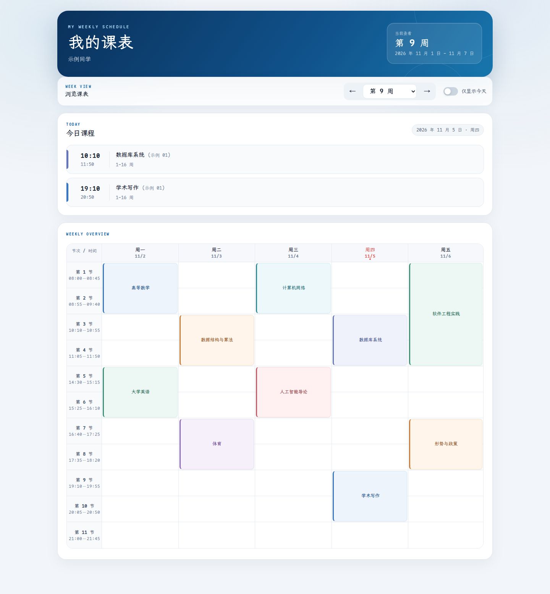

# XMU-CS

厦门大学课表查询工具。使用学号或工号登录统一身份认证，获取学期课表并生成网页，方便在电脑和手机上查看。

## 功能

- 查看今日课程和周一至周五的课表。
- 切换周次，按当前日期自动定位到本周。
- 点击课程查看教师、教室、班级、周次和上课时间。
- 手机端可切换为单列的今日视图，包含当天的周末课程。
- 课表数据保存在生成的页面中，查看时无需重新登录教务系统；更新课表需重新运行脚本。

## 页面示例

以下页面使用模拟数据，中文为霞鹜文楷，英文和数字为 Maple Mono。



[示例 HTML](docs/schedule-demo.html) · [查看原图](docs/schedule-demo.png)

## 使用

```sh
git clone https://github.com/ch-z-hc/XMU-CS.git
cd XMU-CS
pip install -r requirements.txt
```

将 `config.example.json` 复制为 `config.json`，填写账号和密码，然后运行：

```sh
python fetch_schedule.py
```

默认生成并打开 `schedule.html`。可以将页面保存在本地，或放到自己的站点上查看。

## 周次

厦大周次按周日到周六计算。配置中的 `start_date` 填第 1 周的周一；更换学期时需要同步检查。也可以通过 `--week` 手动指定周次。

## 文档

[安装配置、命令参数与页面维护](docs/guide.md)

`config.json` 包含登录凭据，生成的页面包含个人课表。两者都已被 Git 忽略，发布页面前请检查其中的信息。
