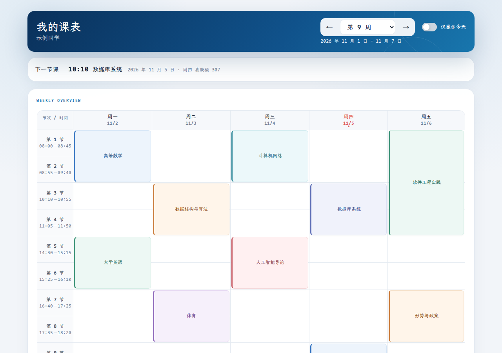

# XMU-CS

把厦门大学课表保存成一张网页，电脑和手机都能看。查下一节在哪里上课，不用每次重新登录教务系统。

## 功能

- **按周查看**：自动定位本周，也可以切换周次查看其他周的安排。
- **只看今天**：手机上切成单列，集中看当天的课，周末课程也会显示。
- **点开看详情**：教师、教室、班级、上课时间和上课周次放在一起。
- **保存后随时查看**：生成的页面自带课表数据；课表有调整时，重新获取一次即可。

周视图展示周一至周五，周次按厦大校历从周日开始计算。

## 开始使用

按[使用指南](docs/guide.md)填写账号并运行程序，生成课表后用浏览器打开即可。

也可以先下载[示例页面](docs/schedule-demo.html)看看效果。上面的截图和示例都使用模拟课程；自己生成的页面包含个人课表，请自行保管。
